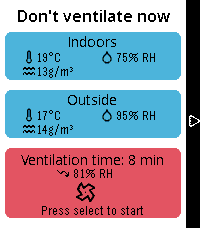
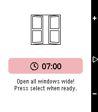
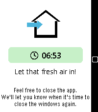
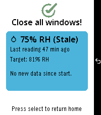

# Ventilate-Pebble

A Pebble Alloy watch application designed to help you practice proper **Lüften** (controlled room ventilation) using real-time sensor data from Home Assistant.

Built using the Pebble Alloy framework—combining embedded JavaScript on the watch (powered by the Moddable XS engine) with a native C wrapper.

---

## What is *Lüften*?

In Germany, **Lüften** (specifically ***Stoßlüften***, or "shock ventilation") is the cultural practice of regularly opening windows wide for short, intense bursts rather than leaving a window tilted (*Kippen*) all day. 

### Why *Stoßlüften*?
* **Prevents Mold:** Human activity (breathing, showering, cooking) rapidly increases indoor relative humidity. High indoor moisture traps against cool exterior walls, creating prime conditions for mold.
* **Saves Energy:** Tilted windows cool down the walls around the window frame, wasting heating energy. Opening windows wide for 5–10 minutes rapidly swaps stale, humid indoor air for fresh outdoor air without letting heat escape from the building structure itself.
* **Replaces CO₂:** It quickly vents indoor pollutants and carbon dioxide.

---

## How It Works

**ventilate** connects your Pebble watch directly to your Home Assistant environment via PebbleKit JS.

1. **Sensor Data Aggregation:** The phone side fetches live temperature and relative humidity readings from your indoor and outdoor Home Assistant sensors.
2. **Absolute Humidity Calculation:** Relative humidity alone can be misleading because warm indoor air holds much more moisture than cold outdoor air. The app calculates the **absolute humidity** ($g/m^3$) for both indoor and outdoor environments.
3. **Smart Duration Suggestion:** Based on the absolute humidity difference and outdoor weather conditions, the app determines:
   * Whether ventilating is currently **recommended**, **cautioned**, or **bad** (e.g. if outdoor air is wetter than indoor air).
   * The **optimal duration** (in minutes) to keep your windows open.
4. **Live Tracking & Summary:** Start the ventilation timer on your wrist. Once finished, the watch prompts you to close your windows and displays a summary of the humidity and temperature drops achieved during the session.

---

## BDS

This project endorses the [Boycott, Divestment, Sanctions](https://bdsmovement.net/) movement against the apartheid state of Israel, in support of Palestinian human rights.

Support requests originating from Israel will not be addressed. Issues and pull requests from anyone, anywhere, that improve the software for everyone else, remain welcome.

---

## Screenshots






---

## Target Platforms

Alloy targets modern Pebble hardware platforms:
* **emery** (Pebble Time 2)
* **gabbro** (Pebble Round 2)

*Other legacy Pebble platforms are currently not supported.*

---

## Project Layout

```text
src/c/mdbl.c                C glue surrounding the Moddable XS runtime
src/embeddedjs/main.js      Embedded JavaScript running on the watch screen
src/embeddedjs/manifest.json Moddable manifest & JS bindings
src/pkjs/index.js          PebbleKit JS running on the phone (HA API requests)
package.json                Project metadata, app UUID, platforms, resources
wscript                     Waf build script
